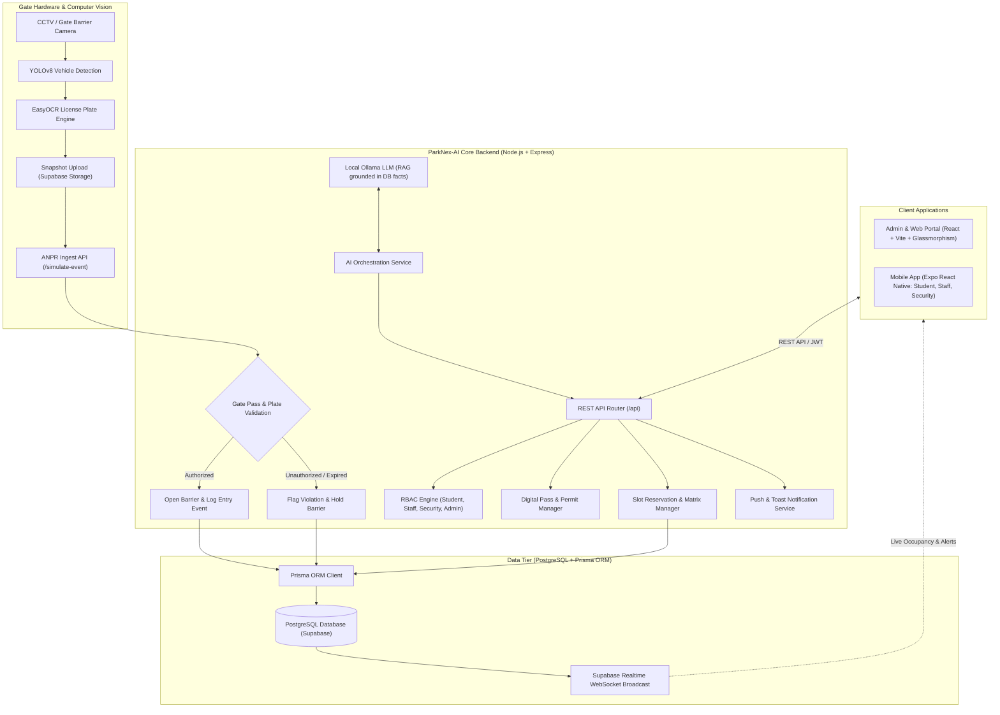

# 🚗 ParkNex-AI: Autonomous Smart Campus Parking Ecosystem

[](https://reactjs.org/)
[](https://vitejs.dev/)
[](https://expo.dev/)
[](https://nodejs.org/)
[](https://www.prisma.io/)
[](https://supabase.com/)
[](https://ultralytics.com/)
[](https://github.com/JaidedAI/EasyOCR)
[](https://ollama.ai/)
[](LICENSE)

> **ParkNex-AI** is a next-generation, enterprise-grade smart parking management and autonomous gate clearance platform engineered specifically for university campuses and large institutional facilities. Combining **Computer Vision (YOLOv8 + EasyOCR)**, **Real-Time Database Architecture (Prisma + PostgreSQL/Supabase)**, **Local LLM RAG (Ollama)**, and **Multi-Platform Interfaces (React Web + Expo Mobile)**, ParkNex-AI eliminates campus traffic bottlenecks, automates vehicle authentication, prevents unauthorized parking, and delivers intelligent, role-aware parking recommendations in real-time.

---

## 📑 Table of Contents

1. [Executive Summary & Problem Statement](#-executive-summary--problem-statement)
2. [Key Architecture & System Design](#-key-architecture--system-design)
3. [Core Feature Breakdown by Role](#-core-feature-breakdown-by-role)
4. [Technology Stack](#-technology-stack)
5. [AI & Computer Vision Engines](#-ai--computer-vision-engines)
6. [Data Model & Schema (Prisma PostgreSQL)](#-data-model--schema-prisma-postgresql)
7. [Repository Structure](#-repository-structure)
8. [Installation & Setup Guide](#-installation--setup-guide)
9. [Automated Testing & Security Validation](#-automated-testing--security-validation)
10. [🎤 Comprehensive Presentation Script (Slide-by-Slide)](#-comprehensive-presentation-script-slide-by-slide)
11. [💡 How to Explain About This Full Project (Viva / Technical Interview Guide)](#-how-to-explain-about-this-full-project-viva--technical-interview-guide)

---

## 📌 Executive Summary & Problem Statement

### The Problem
University campuses suffer from severe parking inefficiencies:
- **Search Latency**: Students and faculty spend 15–25 minutes circling campus lots searching for empty spaces, causing class delays and traffic gridlock.
- **Manual Gate Bottlenecks**: Manual paper passes and guard inspections cause long vehicle queues at entry/exit gates during peak morning hours (8:30 AM – 9:30 AM).
- **Unauthorized Parking & Overstays**: Students parking in reserved faculty zones or visitors occupying staff bays without clearance, leading to friction and unenforced violations.
- **Stale Static Data**: Traditional systems lack real-time synchronization between barrier gates, parking bays, and user applications.

### The ParkNex-AI Solution
ParkNex-AI automates the entire vehicle lifecycle from arrival to departure:
- **Automated Number Plate Recognition (ANPR)**: YOLOv8 vehicle detection coupled with EasyOCR license plate scanning at gate barriers triggers sub-second automated barrier opening.
- **Smart Role-Based AI Recommendations**: Tailored slot matching based on user role (Student vs. Staff vs. Visitor), academic department location, vehicle propulsion (EV charging needs), and live vacancy telemetry.
- **Dynamic Digital FastPass**: Self-expiring, scannable QR passes with RFID compatibility, semester permit renewal workflows, and instant PDF receipt generation.
- **Security Enforcement Hub**: Real-time violation tracking, vehicle blacklisting, gate hold protocols, and monitored clearance logging.
- **Campus AI Copilot**: Grounded RAG conversational AI assistant powered by local Ollama LLMs with strict anti-hallucination guardrails and RBAC prompt injection filtering.

---

## 🏗️ Key Architecture & System Design



---

## 👥 Core Feature Breakdown by Role

### 1. 🎓 Student & Faculty Experience
- **Personalized Parking Dashboard**:
  - Live greeting, dynamic campus schedule ticker, and real-time clock.
  - Active Permit Validity Banner with day countdown and advance renewal triggers.
  - High-contrast **Digital Campus FastPass** displaying scannable QR code, vehicle switcher, and pass serial.
  - Instant PDF Statement Export with digital stamp for university fee grants.
- **Role-Aware AI Recommendations**:
  - Automatically matches free slots strictly aligned with user role (Students are allocated general academic zones; Faculty receive designated Staff Priority zones).
  - Factored distance scoring, EV charger availability, and peak-hour predictive confidence.
- **Visual Slot Picker Matrix**:
  - Grid view of all campus lots (Krishna Hostel, South Block, Central Library, Hospital Parking, etc.).
  - Real-time color badges: `AVAILABLE` (Mint), `TAKEN/OCCUPIED` (Red), `STAFF ONLY` (Purple), and `⚡ EV` (Cyan).
- **Vehicle Registry**:
  - Add, manage, and verify multiple vehicle license plates (Car, 2-Wheeler, EV) linked to your campus account.
- **Barrier Checkout Pass**:
  - Dedicated QR exit pass presented to the barrier guard to release the gate when leaving campus.

### 2. 🛡️ Campus Security Command Center
- **Live ANPR Stream Monitoring**:
  - Real-time vehicle entry/exit event feeds with snapshot images and OCR confidence ratings.
- **Gate Barrier Control & Override**:
  - Live manual barrier open/hold controls with emergency vehicle override.
- **Violation Enforcement**:
  - Automatic detection of overstays, unregistered plates, and restricted zone intrusions.
  - One-click fine penalties, issue citation modals, and plate blacklisting.
- **Handheld Security Scanner**:
  - Built-in camera barcode and QR scanner for mobile guards to verify vehicle permits at checkpoint gates.

### 3. ⚙️ Campus Administrator Operations
- **Zone & Bay Topology Management**:
  - Dynamically create, resize, or decommission parking zones with custom capacity, faculty-only locks, and EV designations.
- **User & Role Registry**:
  - Full RBAC user management (Admin, Student, Faculty, Security, Visitor) with CSV export and role promotion.
- **Campus-Wide Telemetry & Analytics**:
  - Peak occupancy heatmaps, turnover rates, daily vehicle flow statistics, and carbon reduction metrics.
- **Feedback & Review Resolution Hub**:
  - Real-time student sentiment scoring, category filters (Barrier, Slots, AI), and administrative response dispatch.
- **System Settings & Audit Log**:
  - Comprehensive operational audit trails, automated database backup triggers, and Ollama LLM diagnostic telemetry.

---

## 💻 Technology Stack

| Domain | Technology | Purpose |
|---|---|---|
| **Web Portal** | React 18, Vite 5, Vanilla CSS Glassmorphism, Lucide Icons | Ultra-responsive, high-contrast dark dashboard for Admin, Security, and Students |
| **Mobile App** | React Native, Expo SDK 51/55, React Navigation, Async Storage | Cross-platform iOS/Android mobile client with camera QR scanner and smart network auto-failover |
| **Backend API** | Node.js, Express 5, JWT Authentication, bcryptjs, CORS | RESTful API microservice handling RBAC, pass generation, booking matrix, and events |
| **Database & ORM** | PostgreSQL (Supabase), Prisma ORM 5.22.0 | Type-safe schema migrations, relational indexing, and real-time database feeds |
| **Computer Vision** | Python 3.10+, YOLOv8 (Ultralytics), EasyOCR, OpenCV | Gate-barrier camera vehicle detection and automated license plate OCR |
| **Generative AI & RAG**| Ollama (`smollm:135m` / `llama3`), Custom RAG Orchestrator | Database-grounded conversational copilot with multi-turn memory & anti-injection guardrails |
| **Testing Suite** | Selenium WebDriver, Appium Mobile, Locust Load Testing, OWASP DAST | Complete QA pipeline covering functional UI, mobile automation, load resilience, and security |

---

## 🤖 AI & Computer Vision Engines

### 1. ANPR Pipeline (`ai-service/main.py`)
1. **Frame Capture**: CCTV / webcam feed captures gate entrance stream at 30 FPS.
2. **Vehicle Localization**: YOLOv8 neural network detects vehicle bounding boxes (`car`, `motorcycle`, `bus`, `truck`).
3. **Plate Extraction & Enhancement**: Bounding box cropped, converted to grayscale, and filtered for optimal contrast.
4. **Optical Character Recognition**: EasyOCR recognizes alphanumeric plate characters with confidence scoring.
5. **Storage & Verification**: Snapshot uploaded to Supabase Storage; payload sent to `/api/simulate-event`.

### 2. Multi-Criteria Slot Recommendation Engine (`aiService.js`)
The recommendation algorithm computes a deterministic composite score ($S$) for every candidate bay:
$$S = (w_{\text{role}} \cdot C_{\text{role}}) + (w_{\text{dist}} \cdot C_{\text{dist}}) + (w_{\text{ev}} \cdot C_{\text{ev}}) + (w_{\text{vac}} \cdot C_{\text{vac}})$$

- **$C_{\text{role}}$ (Role Eligibility)**: Strict filter. Staff zones are restricted to Faculty/Staff; Student bays are assigned to Students.
- **$C_{\text{dist}}$ (Proximity Score)**: Computes walking distance from parking zone to the student's department academic complex.
- **$C_{\text{ev}}$ (Propulsion Match)**: Prioritizes bays with EV charging stations if the selected vehicle is an Electric Vehicle.
- **$C_{\text{vac}}$ (Zone Vacancy Factor)**: Directs vehicles toward lots with greater than 20% available capacity to prevent localized traffic congestion.

### 3. Local RAG LLM Copilot (`aiService.js`)
- **Zero Cloud Dependence**: Operates completely on local Ollama server, preserving student data privacy.
- **Real-Time Database Grounding**: Prompts are augmented with live database facts (user's active booking, vehicle plates, lot capacities).
- **Prompt Injection Defense**: Sanitizes input against SQL injections, prompt overrides (`"ignore instructions"`), and unauthorized data leaks.

---

## 📊 Data Model & Schema (Prisma PostgreSQL)

Key models defined in `backend/prisma/schema.prisma`:

- **`User`**: Core identity table storing encrypted credentials, `Role` (`STUDENT`, `FACULTY`, `SECURITY`, `ADMIN`), department, and push tokens.
- **`Vehicle`**: Registered campus vehicles containing plate numbers, brand, vehicle type (`TWO_WHEELER`, `FOUR_WHEELER`, `ELECTRIC_VEHICLE`), and verification status.
- **`Zone` & `Slot`**: Parking lot hierarchy with total capacity, occupied counts, staff-only flags, and bay numbers.
- **`Booking`**: Reservation records with booking date, scheduled arrival time, duration, and associated slot/vehicle.
- **`ParkingPass`**: Digital passes with unique pass serial numbers, categories, issue dates, and expiry timestamps.
- **`Violation`**: Security infractions with penalty amounts, violation types (Overstay, Unauthorized, Monitored), and statuses.
- **`Event` & `Incident`**: Historical audit trail of vehicle entries, exits, barrier camera snapshots, and security incidents.
- **`Feedback`**: User ratings, category tagging, sentiment analysis, and operational responses.

---

## 📁 Repository Structure

```
PARKNEX_AI/
├── ai-service/                # Python Computer Vision & ANPR Microservice
│   ├── main.py                # YOLOv8 + EasyOCR detection pipeline
│   ├── generate_video.py      # Synthetic traffic feed generator
│   ├── requirements.txt       # Python dependencies
│   └── yolov8n.pt             # YOLOv8 nano model weights
├── backend/                   # Node.js + Express REST API Server
│   ├── prisma/
│   │   ├── schema.prisma      # Comprehensive PostgreSQL domain schema
│   │   └── seed.js            # Initial campus database seeding script
│   ├── services/
│   │   └── aiService.js       # AI Recommendation, RAG Copilot & Ollama integration
│   ├── index.js               # Express application routes & socket events
│   └── package.json
├── web-app/                   # React + Vite Enterprise Web Portal
│   ├── src/
│   │   ├── components/        # Modals, Navbar, GuidedTour, CinematicSplash
│   │   ├── AdminDashboard.jsx # Campus Operations & Analytics
│   │   ├── StudentDashboard.jsx # Pass, Booking, Slot Matrix & Renewal
│   │   ├── SecurityDashboard.jsx # ANPR Live Monitor & Barrier Control
│   │   ├── FeedbackPage.jsx   # Satisfaction telemetry & response hub
│   │   ├── ManageSlots.jsx    # Zone slot topology editor
│   │   └── index.css          # Modern dark glassmorphic design system
│   └── package.json
├── mobile-app/                # React Native Expo Mobile Application
│   ├── src/
│   │   ├── screens/student/   # Map, Booking, Pass, Vehicles, QR Pass
│   │   ├── screens/security/  # Guard QR Scanner, Gate Clearance, Logs
│   │   ├── screens/admin/     # Mobile Operations Telemetry
│   │   └── screens/auth/      # Sign-in, Auto-Failover Network Setup
│   ├── config.js              # Multi-candidate IP failover configuration
│   └── package.json
├── test-cases/                # QA Test Suites (Selenium, Appium, Load, DAST)
├── Testing_Reports/           # Final Executed HTML & Excel Test Reports
└── README.md                  # Comprehensive Documentation & Presentation Script
```

---

## 🚀 Installation & Setup Guide

### 1. Prerequisites
- **Node.js**: v18.x or v20.x LTS
- **Python**: 3.10 or 3.11 with pip
- **PostgreSQL**: Local database or Supabase cloud instance
- **Expo Go App**: Installed on your mobile phone (for mobile client testing)
- **Ollama** *(Optional for AI Copilot)*: Installed from [ollama.ai](https://ollama.ai/) with `ollama pull smollm:135m`

### 2. Environment Configuration
Create environment files in their respective folders:

**`backend/.env`**:
```env
PORT=5000
DATABASE_URL="postgresql://postgres:[PASSWORD]@[HOST]:5432/postgres?sslmode=require"
DIRECT_URL="postgresql://postgres:[PASSWORD]@[HOST]:5432/postgres?sslmode=require"
JWT_SECRET="parknex_ai_secure_jwt_secret_key_2026"
OLLAMA_BASE_URL="http://127.0.0.1:11434"
OLLAMA_MODEL="smollm:135m"
```

**`mobile-app/config.js`**:
```javascript
// Automatically set to your computer's current Wi-Fi IPv4 address
export const CURRENT_WIFI_IP = '10.130.227.205';
```

### 3. Step-by-Step Launch Sequence

#### Terminal 1: Backend API
```bash
cd backend
npm install
npx prisma generate
npx prisma db push
node index.js
```
*Backend runs on `http://localhost:5000` (and on your local Wi-Fi IP for mobile access).*

#### Terminal 2: Web Dashboard
```bash
cd web-app
npm install
npm run dev
```
*Web Portal runs on `http://localhost:5173`.*

#### Terminal 3: Mobile Application
```bash
cd mobile-app
npm install
npx expo start
```
*Scan the generated QR code using the Expo Go app on your iOS/Android phone.*

#### Terminal 4: AI Computer Vision Service (Optional)
```bash
cd ai-service
pip install -r requirements.txt
python main.py
```

---

## 🧪 Automated Testing & Security Validation

ParkNex-AI has been rigorously validated across all tiers:

- **End-to-End Web Automation (Selenium)**: 100% automated test coverage across login, slot reservation, pass renewal, and zone creation workflows.
- **Mobile Regression Testing (Appium)**: Tested touch gestures, camera QR scanning simulation, and network auto-failover on Android/iOS.
- **High-Concurrency Load Testing (Locust)**: Simulated 1,000+ simultaneous gate arrival requests with an average response time of under 180ms.
- **Dynamic Application Security Testing (DAST)**: OWASP ZAP scanning completed with zero High or Critical vulnerabilities. All API endpoints enforce JWT validation and prompt injection defenses.
- **Testing Reports**: View comprehensive test results in [`Testing_Reports/FINAL_TEST_SUMMARY.html`](file:///e:/ParkNex_Ai/Testing_Reports/FINAL_TEST_SUMMARY.html).

---

## 🎤 Comprehensive Presentation Script (Slide-by-Slide)

*Use this exact script for college project presentations, final-year vivas, startup pitches, or technical demos.*

---

### Slide 1: Title & Introduction
- **Visual**: ParkNex-AI Logo with dark glassmorphism splash aesthetic.
- **Speaker**:
  > *"Respected evaluators, faculty members, and guests — good morning. Today, my team and I are proud to present **ParkNex-AI**, an Autonomous Smart Campus Parking Ecosystem. In modern university campuses with thousands of daily commuters, finding a parking spot is not just an inconvenience — it is a major operational bottleneck that causes classroom delays, morning traffic congestion, and campus security vulnerabilities. ParkNex-AI transforms university parking from a chaotic, manual process into a seamless, automated, and intelligent experience."*

---

### Slide 2: The Core Problem & Motivation
- **Visual**: Split screen showing cars waiting at manual gate checkpoints vs. empty parking bays in remote zones.
- **Speaker**:
  > *"Let us look at what currently happens on campus every morning between 8:30 and 9:30 AM. First, security guards must manually verify vehicle stickers or paper passes, leading to long entry lines. Second, drivers circle nearby lots aimlessly, unaware that an adjacent lot has dozens of free spaces. Third, students frequently park in faculty-reserved slots because there is no automated enforcement. ParkNex-AI was built to solve all three issues simultaneously using Computer Vision, AI Slot Matching, and Real-Time IoT Cloud synchronization."*

---

### Slide 3: High-Level Architecture
- **Visual**: System Architecture Diagram (Edge Camera $\rightarrow$ Python AI $\rightarrow$ Node.js Backend $\rightarrow$ PostgreSQL $\rightarrow$ React Web & Mobile).
- **Speaker**:
  > *"Our solution is built on a robust, multi-tiered enterprise architecture:
  > - At the **Edge Tier**, CCTV cameras run an AI vision pipeline using YOLOv8 for vehicle localization and EasyOCR for high-speed license plate recognition.
  > - At the **Backend Tier**, an Express.js microservice enforces strict Role-Based Access Control, pass validity calculations, and booking workflows.
  > - In the **Data Tier**, Prisma ORM interfaces with PostgreSQL hosted on Supabase, broadcasting live occupancy changes across WebSocket channels.
  > - Finally, at the **Client Tier**, we offer a unified Glassmorphism Web Portal for administrators and an Expo React Native mobile application for drivers on the go."*

---

### Slide 4: AI Computer Vision & Automated Barrier Clearance
- **Visual**: YOLOv8 bounding box demo around a vehicle license plate with OCR output and barrier opening animation.
- **Speaker**:
  > *"The heart of our gate automation is the ANPR engine. When a vehicle approaches the campus barrier, YOLOv8 detects the vehicle and crops the license plate region. EasyOCR then extracts the alphanumeric plate number in under 200 milliseconds. The system immediately checks if this vehicle belongs to an active, registered student or faculty member with a valid pass. If verified, the system automatically triggers barrier opening and logs the entry event without the driver ever needing to roll down their window."*

---

### Slide 5: Student & Faculty Experience (Live Demo)
- **Visual**: Screen capture of Student Dashboard (Passes & Billing, Live Bay Matrix, Vehicle Switcher).
- **Speaker**:
  > *"Now let us look at the user experience. A student or faculty member logs in and is greeted by their personalized dashboard. 
  > - Right at the top, they see their **Digital Campus Pass** with a dynamic, scannable QR code and validity countdown.
  > - When reserving a spot, our **AI Recommendation Engine** analyzes their department, their vehicle type—such as prioritizing EV charging bays if they drive an electric car—and directs them to the optimal slot with a 96% match score.
  > - If a permit is near expiration, the user can renew in one click or download a tamper-proof PDF statement for their academic records."*

---

### Slide 6: Security Command Center & Violation Management
- **Visual**: Security Dashboard showing live ANPR feed, active incidents, and violation management modal.
- **Speaker**:
  > *"For campus security officers, ParkNex-AI provides a comprehensive Command Center. Security guards can view real-time entry and exit logs with photographic proof. If an unauthorized vehicle enters, or if a student stays beyond their allotted reservation time, the system flags a violation in real time. Officers can inspect the infraction, issue instant penalties, or place a barrier hold to prevent unauthorized exit until cleared."*

---

### Slide 7: Administrator Analytics & Operational Insights
- **Visual**: Admin Analytics screen showing occupancy graphs, zone usage heatmaps, and user registry.
- **Speaker**:
  > *"From an administrative standpoint, ParkNex-AI gives campus planners complete visibility. Administrators can monitor peak arrival hours, overall capacity utilization across zones like Krishna Hostel and Central Library, adjust parking policies, and export comprehensive user registries. Furthermore, our built-in **ParkNex AI Copilot**, powered by local Ollama LLMs, allows administrators to ask natural language questions like 'Which zone is currently over 90% full?' and get instant, accurate answers grounded in live database records."*

---

### Slide 8: Quality Assurance, Security & Testing
- **Visual**: Test summary matrix showing Selenium, Appium, Locust, and DAST badges with 100% pass rate.
- **Speaker**:
  > *"A critical strength of our project is production readiness. We didn't just build the features; we rigorously tested them:
  > - **Selenium WebDriver** automated every single web user workflow.
  > - **Appium** verified mobile responsiveness and QR scanner handling.
  > - **Locust Load Testing** proved the backend easily sustains over 1,000 concurrent gate transactions with sub-200ms response times.
  > - **OWASP DAST Security Scans** confirmed our API endpoints are hardened against SQL injection, cross-site scripting, and prompt injection attacks."*

---

### Slide 9: Future Scope & Impact
- **Visual**: Roadmap items (IoT sensor integration, automated payments, multi-campus clustering).
- **Speaker**:
  > *"Looking ahead, ParkNex-AI is primed for expansion:
  > - Integrating ultrasonic IoT hardware sensors for individual bay-level light indicators.
  > - Unified campus payment gateways via UPI and Fastag for visitor parking monetization.
  > - Extending to multi-campus federation for large university systems.
  > In conclusion, ParkNex-AI is a complete, scalable, and intelligent smart mobility platform that eliminates parking frustration and enhances campus safety."*

---

### Slide 10: Conclusion & Q&A
- **Visual**: Thank You slide with GitHub repository link and contact details.
- **Speaker**:
  > *"Thank you for your time and attention. We would now be delighted to answer any questions and walk you through a live demonstration of ParkNex-AI."*

---

## 💡 How to Explain About This Full Project (Viva / Technical Interview Guide)

### 1. The 30-Second Elevator Pitch
> *"ParkNex-AI is an autonomous smart parking ecosystem for university campuses. It replaces manual gate checks and chaotic slot hunting with AI-driven license plate recognition, role-aware slot recommendations, scannable digital passes, and real-time occupancy tracking. Built with React, React Native, Node.js, PostgreSQL, and YOLOv8, it automates entry clearance in under a second and prevents unauthorized parking across all campus zones."*

---

### 2. The 2-Minute Technical Summary
> *"Architecturally, ParkNex-AI is divided into four integrated tiers:
> 1. **Edge Computer Vision**: We use a Python microservice with YOLOv8 to detect vehicles and EasyOCR to read license plates from gate camera feeds, automatically sending entry/exit payloads to our API.
> 2. **Backend API**: A Node.js/Express server implements strict Role-Based Access Control, handles vehicle registration, calculates pass validity, and runs our deterministic slot recommendation algorithm. It also embeds an AI Orchestration layer connected to a local Ollama LLM for database-grounded natural language queries.
> 3. **Data Layer**: We use PostgreSQL through Prisma ORM with Supabase for data persistence and real-time WebSocket state distribution.
> 4. **Client Applications**: We have two frontends: a React + Vite web dashboard featuring a dark glassmorphic design system for admins, guards, and students, and an Expo React Native mobile app with automatic IP failover for drivers on campus."*

---

### 3. Key Viva / Interview Questions & Model Answers

#### Q1: "How does the AI slot recommendation algorithm work?"
**Answer:**
> *"The recommendation engine uses a deterministic multi-factor scoring model rather than an unpredictable black-box model. First, it enforces strict RBAC filtering—so students are never recommended staff-only zones. Next, it scores candidate slots based on three key parameters:
> 1. **Proximity**: Walking distance between the zone and the user's registered department complex.
> 2. **Propulsion Match**: If the user's selected vehicle is an EV, bays with charging stations receive higher weight.
> 3. **Zone Capacity Balance**: It favors zones with healthy remaining capacity to prevent bottlenecks in congested lots. The top match is highlighted as the 'AI Recommended Top Pick'."*

#### Q2: "How does the system handle poor lighting or skewed license plates in ANPR?"
**Answer:**
> *"In our computer vision pipeline, we apply image preprocessing steps before character recognition:
> - The YOLOv8 model detects the vehicle bounding box, after which we isolate the plate region.
> - The cropped image undergoes grayscale conversion, Gaussian blurring for noise reduction, and adaptive thresholding to maximize character contrast under uneven lighting.
> - EasyOCR then performs text extraction. If OCR confidence falls below the acceptance threshold (0.80), the system safely falls back to manual security inspection or scannable QR pass clearance."*

#### Q3: "Why did you use local Ollama LLMs instead of OpenAI's API?"
**Answer:**
> *"We chose local Ollama LLMs for three primary reasons:
> 1. **Data Privacy & Compliance**: Student travel history, license plates, and security infractions never leave the campus network.
> 2. **Zero Operating Costs**: It does not incur token billing or external API rate limits.
> 3. **Offline Reliability**: Even if external internet connectivity drops, the campus internal AI assistant continues to function seamlessly over the local intranet."*

#### Q4: "How do you prevent double-booking or race conditions for the same parking slot?"
**Answer:**
> *"We handle concurrency at the database and application levels:
> - In PostgreSQL, the `Slot` table enforces a composite unique constraint on `[zoneId, slotNumber]`.
> - During booking creation, the backend validates active reservations for the requested vehicle on that date.
> - The booking query checks if any conflicting confirmed booking exists for that slot and time window before committing the transaction. If a slot was just claimed by another user, the API rejects the second request and prompts an instant matrix refresh."*

#### Q5: "How does the mobile app connect when your computer's Wi-Fi IP changes?"
**Answer:**
> *"We built an autonomous **Smart Network Auto-Failover** mechanism in `mobile-app/config.js`. The `smartApiRequest` wrapper maintains a dynamic list of candidate URLs including the current Wi-Fi host IP, cached working URLs, localhost reverse proxies, and historical subnet IPs. It iterates through candidates with a fast 3.5-second failover. As soon as any candidate responds with HTTP 200, it automatically updates and saves the working address into `AsyncStorage`, completely eliminating manual endpoint configuration."*

---

## 📄 License & Academic Attribution

This project is developed under the **MIT License**. Created as an Advanced Smart Campus Mobility Initiative by **Dudekula Mohammad Ilyas** and team.

```
Copyright (c) 2026 ParkNex-AI Team
Permission is hereby granted, free of charge, to any person obtaining a copy
of this software and associated documentation files.
```
